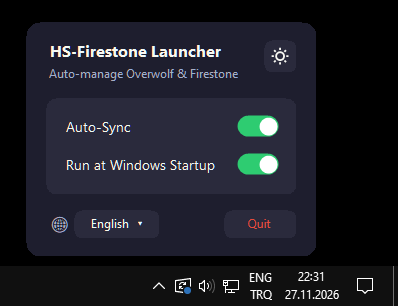

# HS-Firestone Launcher

> **Automatic Overwolf & Firestone manager for Hearthstone on Windows** — zero config, lives in your system tray.

[](https://github.com/cenkakay08/hs-firestone-launcher/actions/workflows/release.yml)
[](LICENSE)
[](https://github.com/cenkakay08/hs-firestone-launcher/releases/latest)
[](https://github.com/cenkakay08/hs-firestone-launcher/releases/latest)

**HS-Firestone Launcher** is a lightweight Windows system tray utility that automatically launches **Overwolf** and **Firestone** the moment **Hearthstone** starts, and cleanly kills all Overwolf background processes the moment Hearthstone exits — no manual intervention, no leftover RAM or CPU usage.

<p align="center">
  
</p>

---

## ✨ Features

| Feature | Detail |
|---|---|
| 🚀 **Auto-Launch** | Detects `Hearthstone.exe` via WMI event watcher and starts Overwolf instantly |
| ⚡ **Instant Cleanup** | Kills `Overwolf`, `OverwolfBrowser`, `OverwolfHelper` the moment Hearthstone exits |
| 🔔 **System Tray Flyout** | Borderless, rounded flyout — click tray icon to open/close |
| 🌗 **Dark & Light Mode** | Toggle anytime with the Sun/Moon button |
| 🌍 **12 Languages** | Auto-detects Windows system language; manually switchable |
| 🔁 **Run at Startup** | One-click Windows startup toggle (no admin rights required) |
| 🛡️ **Single Instance** | Named `Mutex` prevents duplicate processes |
| 📦 **No Installer** | Single `.exe`, no setup wizard, no registry bloat |

### Supported Languages
`English` · `Türkçe` · `Deutsch` · `Français` · `Español` · `Italiano` · `Português` · `Русский` · `Polski` · `日本語` · `한국어` · `中文`

---

## 📥 Download & Install

1. Go to [**Releases**](https://github.com/cenkakay08/hs-firestone-launcher/releases/latest) and download `HsFirestoneLauncher.exe`
2. Place it anywhere (e.g. `C:\Tools\`)
3. Double-click to run — it goes straight to the system tray

> **Requirements:** Windows 10 / 11 · [.NET 8 Desktop Runtime](https://dotnet.microsoft.com/en-us/download/dotnet/8.0) · [Hearthstone](https://hearthstone.blizzard.com/) · [Overwolf](https://www.overwolf.com/) + [Firestone](https://www.firestoneapp.gg/)

---

## 🖥️ Usage

| Action | How |
|---|---|
| Open settings flyout | Left or right-click the tray icon |
| Toggle auto-sync | Flip the **Auto-Sync** switch in the flyout |
| Toggle Windows startup | Flip the **Run at Startup** switch |
| Switch dark / light mode | Click the ☀️/🌙 button (top-right of flyout) |
| Change language | Click the 🌐 globe button (bottom-left of flyout) |
| Quit | Click **Quit** in the flyout |

---

## ⚙️ How It Works

```
Hearthstone.exe starts
        │
        ▼
  WMI EventWatcher fires (no polling, event-driven)
        │
        ▼
  Overwolf.exe launched (15s cooldown prevents double-launch)
        │
        ▼
  Process.Exited hook attached to Hearthstone
        │
        ▼
  Hearthstone closes → Overwolf + OverwolfBrowser + OverwolfHelper killed
```

- Uses `ManagementEventWatcher` with a WQL query — **no CPU polling**
- Overwolf path is discovered from the 32-bit Program Files directory or the Overwolf registry install path (picks newest version)
- Startup registry key: `HKCU\Software\Microsoft\Windows\CurrentVersion\Run` — **no admin rights needed**

---

## 🔒 Security & SmartScreen

Builds are fully automated via [GitHub Actions](.github/workflows/release.yml) — no manual steps, no unsigned binaries injected. You can audit every build step in the workflow file.

**If Windows shows "Windows protected your PC":**
1. Click **More info**
2. Click **Run anyway**

This prompt appears because the app does not yet have an EV code-signing certificate (pending SSL.com open-source program approval). The source code and build pipeline are fully public.

### Windows Startup

When the app launches automatically at Windows startup, the same warning may appear.

Follow the steps above to run the app.
The app starts via the `HKCU\Software\Microsoft\Windows\CurrentVersion\Run` registry key, so no administrator rights are required.

---

## 🏗️ Build from Source

```bash
git clone https://github.com/cenkakay08/hs-firestone-launcher.git
cd hs-firestone-launcher

# Requires .NET 8 SDK
dotnet publish HsFirestoneLauncher\HsFirestoneLauncher.csproj --configuration Release --runtime win-x64 --output out
```

The output `out\HsFirestoneLauncher.exe` is your ready-to-run binary.

---

## 🧪 Download a Dev Build

The **PR Checks** workflow uploads a Windows build artifact retained for 14 days for pull requests targeting `dev` and direct pushes to `dev`. For a pull request, open its **Checks** tab and follow the **PR Checks** run; download `HsFirestoneLauncher-dev-<commit>` from that run's **Artifacts** section.

---

## 🤝 Contributing

Pull requests are welcome! Please branch off `dev` and open a PR targeting `dev`.

---

## 📄 License

[MIT](LICENSE) © 2026 cenkakay08

